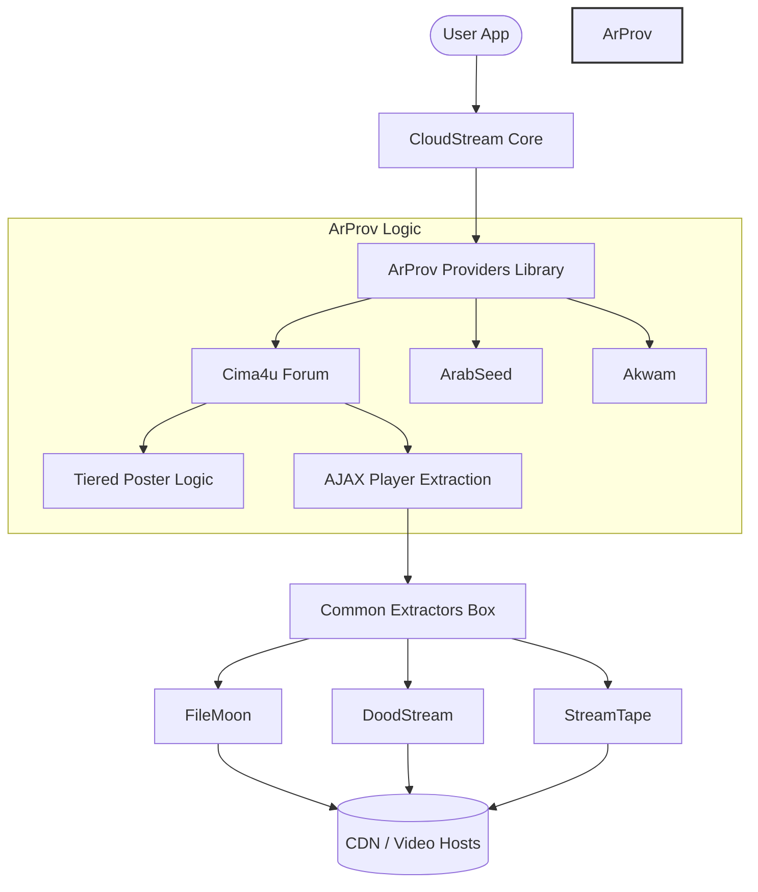

# 🎬 ArProv - Professional Arabic CloudStream Extensions

<p align="center">
  
  
  
</p>

<p align="center">
  <strong>The Gold Standard for Arabic Content on CloudStream. Clean, High-Performance, and Community-Driven.</strong>
</p>

<p align="center">
  <a href="README.md"><strong>العربية</strong></a> | <strong>English</strong>
</p>

## 📊 Statistics
- **Active Sites**: 21+ Providers
- **Extractors**: 15+ Extractors
- **Languages**: Arabic & English
- **Quality**: 4K, 1080p, 720p

---

## 🏗️ System Architecture

ArProv is designed with a modular architecture that separates content sourcing (Providers) from video link retrieval (Extractors). This ensures maximum stability and easy maintenance.



---

## 🚀 Key Features

*   🛡️ **Tiered Poster Extraction**: proprietary logic to ensure 100% catch rate for movie posters using local UI scoping and safe meta-tag fallbacks.
*   ⚡ **AJAX Player Retrieval**: Direct communication with server backends (`admin-ajax.php`) to bypass obfuscated frontend code.
*   🌍 **Universal Compatibility**: Optimized for Android, Android TV, and Web interfaces.
*   💎 **Premium Quality**: Support for multi-resolution streaming (4K, 1080p, 720p).

---

## 📦 Extension Directory

> [!IMPORTANT]
> **Status Check**: All providers listed below are fully functional and optimized, except for those specifically mentioned in the **Blocked / Not Working** section.

### ✅ Active & Optimized
| Provider | Genre | Package Name |
| :--- | :--- | :--- |
| **ArabSeed** | Movies & Series | `com.lagradost.cloudstream3.arabseed` |
| **Akwam** | General Entertainment | `com.lagradost.cloudstream3.akwam` |
| **FaselHD** | Arabic & International | `com.lagradost.cloudstream3.faselhd` |
| **Anime4up** | Anime & Movies | `com.lagradost.cloudstream3` |
| **MovizLand** | Movies & Series | `com.lagradost.cloudstream3.movizlands` |
| **Cima4U** | Movies & Series | `com.lagradost.cloudstream3.cima4u` |
| **CimaClub** | Movies & Series | `com.lagradost.cloudstream3.cimaclub` |
| **QisatTv** | Series & Story | `com.lagradost.cloudstream3.qisat` |
| **Fushaar** | Movies & Series | `com.lagradost.cloudstream3.fushaar` |
| **EgyBest** | Movies & Series | `com.lagradost.cloudstream3.egybest` |
| **EgyDead** | Movies & Series | `com.lagradost.cloudstream3.egydead` |
| **MyCima** | Movies & Series | `com.lagradost.cloudstream3.mycima` |
| **Shahid4u** | Movies & Series | `com.lagradost.cloudstream3.shahid4u` |
| **RistoAnime** | Dedicated Anime | `com.lagradost.cloudstream3.ristoanime` |
| **Tuk Tuk Cinema** | Movies & Series | `com.lagradost.cloudstream3.tuk` |
| **TopCinema** | Movies & Series | `com.lagradost.cloudstream3.topcinema` |
| **Shoffree** | Movies & Series | `com.lagradost.cloudstream3.shoffree` |
| **Alkawthar TV** | Series, Movies & Documentaries | `com.lagradost.cloudstream3.alkawthar` |
| **GogoAnime** | Anime (Sub/Dub) | `com.lagradost.cloudstream3.gogoanime` |

> [!NOTE]
> **Fushaar**: Some posters may be missing. This is an issue with the source website, not the extension.

### 🛠️ In Development (Coming Soon)
- [ ] **Extra Sourced Providers** - `Movies & Series`
> [!TIP]
> **Have a suggestion?** If you'd like to see a specific website added as a provider, feel free to open an issue or reach out!
### 🚫 Blocked / Discontinued / Under Maintenance
These providers are currently blocked, discontinued due to expired domains, or undergoing provider server maintenance.

| Provider | Reason | Status |
| :--- | :--- | :--- |
| **GateAnime** | Domain expired and website discontinued with no alternative | `Disabled` |
| **Cima4u Forum** | Forum website shut down with no current alternative | `Disabled` |
| **CimaNow** | Public player servers disabled / undergoing maintenance | `Under Maintenance` |
| **CimaLeek** | Turnstile protection and server system overhaul | `Under Maintenance` |
| **AnimeBlkom** | Cloudflare Block | `Disabled` |
| **FajerShow** | Cloudflare Block | `Disabled` |
| **ShahidMBC** | Geo-blocked / DRM | `Disabled` |
| **Animeiat** | Website Closed | `Disabled` |

---

## 🔧 Installation & Setup

> [!IMPORTANT]
> **Required Component**: You **MUST** install the **Extractors** extension from this repository. Most providers (like Fushaar, Akwam, etc.) rely on the common Extractors box to retrieve video links. Without it, you will see "No link found" errors.

### Instant Repositories
You can use the **shortcode** directly in CloudStream:
```text
arprov
```

Or copy and paste this URL into your CloudStream settings:

```text
https://raw.githubusercontent.com/ramailo1/arprov/main/repo.json
```

### Manual Build
```bash
./gradlew build
```

---

## 📝 Attribution & Legal

> [!NOTE]
> This project is a refined fork of [dhomred/cloudstream-extensions-arabic-v2](https://github.com/dhomred/cloudstream-extensions-arabic-v2).
> Re-architected and maintained by **ramailo1**.

## 🏆 Hall of Fame
We honor the brilliant minds who have contributed to the success of ArProv.

| Contributor | Achievement | Impact |
| :--- | :--- | :--- |
| **[Abodabodd](https://github.com/Abodabodd)** | **Anti-Scraping & Server Logic** | Unlocked `CimaNow` provider capabilities. |
| **[dhomred](https://github.com/dhomred)** | **Original Architect** | Foundation of the v2 extensions. |

Want to be here? Submit a fix or new provider!

Distributed under the **MIT License**. See [LICENSE](LICENSE) for more information.

---

<p align="center">
  ⭐ <strong>Support our work by starring this repository!</strong> ⭐
</p>
